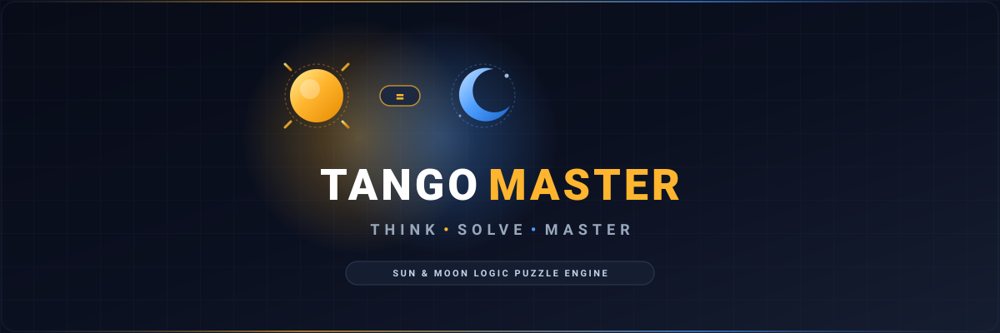
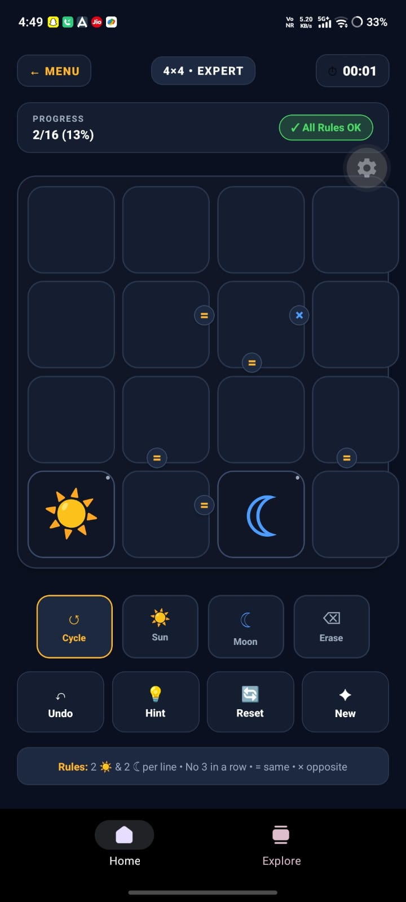

<div align="center">
  

  # TANGO MASTER

  <p><strong>Think. Solve. Master.</strong></p>

  <p>
    An elegant celestial logic puzzle game inspired by binary grid challenges, built with <strong>React Native</strong>, <strong>Expo SDK 58</strong>, and <strong>TypeScript 6</strong>.
  </p>

  <p>
    <a href="https://reactnative.dev/"></a>
    <a href="https://expo.dev/"></a>
    <a href="https://www.typescriptlang.org/"></a>
    <a href="LICENSE"></a>
  </p>
</div>

---

## 📖 Project Overview

**TANGO MASTER** is a modern, responsive mobile and web puzzle application based on the classic *Tango* (also known as *Takuzu* or *Binairo*) binary determination puzzle. Players must fill an $N \times N$ grid with celestial **Suns (☀)** and **Moons (☾)** while obeying mathematical parity balance, sequence limits, and adjacency relations.

Every puzzle is generated procedurally with a guaranteed unique solution through a dedicated constraint-satisfaction backtracking solver and intelligent hint engine.

---

## 🎮 How to Play — The Five Rules

Every cell on the board must ultimately contain either a **Sun (☀)** or a **Moon (☾)**. A board is completed and valid only when all five core constraints are satisfied:

| Rule | Constraint | Description |
|:---:|:---|:---|
| **1** | **Row Parity Balance** | Every row must contain exactly $N/2$ Suns and $N/2$ Moons. |
| **2** | **Column Parity Balance** | Every column must contain exactly $N/2$ Suns and $N/2$ Moons. |
| **3** | **No Three Consecutive** | Never place three identical symbols consecutively in any row or column (e.g. ☀☀☀ and ☾☾☾ are strictly forbidden). |
| **4** | **Equal Signs (`=`)** | Adjacent cells connected by an equal sign (`=`) must contain **identical** symbols (☀ = ☀ or ☾ = ☾). |
| **5** | **Cross Signs (`×`)** | Adjacent cells connected by a cross sign (`×`) must contain **opposite** symbols (☀ × ☾ or ☾ × ☀). |

---

## ✨ Features

- **Multi-Size Grids**: Play on **4×4 (Beginner)**, **6×6 (Standard)**, and **8×8 (Advanced)** puzzle dimensions.
- **Four Difficulty Tiers**: Tuned clue ratios and constraint densities for **Easy**, **Medium**, **Hard**, and **Expert**.
- **Procedural Generation**: Fast grid generator using precomputed valid row permutations to guarantee valid, unique puzzles.
- **Intelligent Hint System**: Deterministic logical deductions that explain *why* a move is forced (3-in-a-row avoidance, row/column balance, or constraint deductions).
- **Live Error Feedback**: Highlights conflicting cells and violated constraint badges in real time.
- **Intuitive Controls**: Tap cells to cycle (`Empty` $\rightarrow$ `☀ Sun` $\rightarrow$ `☾ Moon` $\rightarrow$ `Empty`), or use dedicated toolbar buttons for direct symbol placement and erasure.
- **Undo & Restart**: Multi-step move history stack for unlimited undo and clean board resets.
- **Timer & Victory Modal**: Tracks completion time with tabular digits and displays detailed end-of-game statistics.
- **Responsive Architecture**: Fluid UI that scales smoothly across Android, iOS, and Web devices.

---

## 📱 Application Screenshots

<div align="center">

### Home Screen & Lobby
*Select grid dimensions, adjust difficulty, access daily challenges, and review game rules.*


---

### Puzzle Gameplay by Grid Size

<table>
  <tr>
    <td align="center" width="33%">
      <strong>4×4 Beginner Grid</strong><br />
      <em>Quick logic warm-up with direct deductions</em><br /><br />
      
    </td>
    <td align="center" width="33%">
      <strong>6×6 Standard Grid</strong><br />
      <em>Balanced celestial puzzle challenge</em><br /><br />
      
    </td>
    <td align="center" width="33%">
      <strong>8×8 Advanced Grid</strong><br />
      <em>Deep strategic multi-step deductions</em><br /><br />
      
    </td>
  </tr>
</table>

</div>

---

## 🧠 Game Logic Architecture

The puzzle engine is strictly separated from presentation logic:

- **[`validation.ts`](src/game/validation.ts)**: Pure constraint validator enforcing row/column balance, consecutive identical restrictions, and adjacent equal/cross relations.
- **[`solver.ts`](src/game/solver.ts)**: Backtracking constraint-satisfaction solver with solution counting and deductive hint explanations.
- **[`generator.ts`](src/game/generator.ts)**: Procedural puzzle synthesizer that extracts valid board solutions, samples edge constraints, and verifies solution uniqueness.
- **[`use-game-state.ts`](src/game/use-game-state.ts)**: Core React hook orchestrating board state, move history, undo stack, timer, and victory triggers.
- **[`settings.ts`](src/game/settings.ts)**: Preference persistence adapter supporting web storage and native file storage with defensive schema validation.
- **[`audio.ts`](src/game/audio.ts)**: Web Audio API synthesizer for celestial chimes and cross-platform haptic feedback vibration triggers.

---

## 🛠️ Technology Stack

| Layer | Technologies |
|:---|:---|
| **Framework** | [React Native 0.88.1](https://reactnative.dev/) • [React 19.3.0](https://react.dev/) |
| **Tooling & Runtime** | [Expo SDK 58.0.25](https://expo.dev/) • [Expo Router 58.0.31](https://docs.expo.dev/router/introduction/) |
| **Language** | [TypeScript 6.0.3](https://www.typescriptlang.org/) (Strict Mode) |
| **State & Navigation** | React Hooks & Context • File-Based Routing |
| **Styling** | React Native StyleSheet with custom dark navy (`#0B1020`) and gold (`#FFB52E`) design system |

---

## 📁 Project Structure

```text
tango-master/
├── assets/
│   ├── tango-master-banner.svg   # Project vector banner
│   ├── images/                   # App icons, splash screens, and badges
│   └── screenshots/              # High-resolution application screenshots
│       ├── home-screen.png       # Main menu and setup screen
│       ├── 4X4.png               # 4×4 grid gameplay
│       ├── 6X6.png               # 6×6 grid gameplay
│       └── 8X8.png               # 8×8 grid gameplay
├── scripts/
│   ├── test-loader.mjs           # Node test runner hook loader
│   └── test-resolver.mjs         # TypeScript ESM module resolver
├── src/
│   ├── app/                      # Expo Router navigation routes
│   │   ├── _layout.tsx           # Root theme & settings provider layout
│   │   ├── index.tsx             # Home screen lobby & game launcher
│   │   └── explore.tsx           # Documentation & guides tab
│   ├── components/
│   │   ├── game/                 # Game UI components
│   │   │   ├── CompletionModal.tsx # Victory celebration modal
│   │   │   ├── ConstraintBadge.tsx # Equal (=) & Cross (×) badges
│   │   │   ├── GameView.tsx        # Main playable puzzle screen
│   │   │   ├── PuzzleCell.tsx      # Interactive Sun/Moon cell
│   │   │   └── PuzzleGrid.tsx      # Responsive grid layout
│   │   ├── settings/
│   │   │   └── SettingsView.tsx    # Preferences & options view
│   │   └── app-tabs.web.tsx      # Web tab bar navigation
│   └── game/                     # Core puzzle engine modules
│       ├── __tests__/            # Automated unit test suites
│       │   ├── puzzle.test.ts    # Constraint & generator tests
│       │   └── settings.test.ts  # Persistence & settings tests
│       ├── audio.ts              # Audio chime synthesis & haptics
│       ├── colors.ts             # Theme color definitions
│       ├── generator.ts          # Procedural board generation
│       ├── settings.ts           # Settings state & storage adapter
│       ├── solver.ts             # Constraint solver & hint engine
│       ├── types.ts              # Engine type definitions
│       ├── use-game-state.ts     # Game state management hook
│       └── validation.ts         # Puzzle rule validation logic
├── app.json                      # Expo application manifest
├── package.json                  # Dependencies & scripts
└── tsconfig.json                 # Strict TypeScript configuration
```

---

## 🚀 Getting Started

### Prerequisites

- [Node.js](https://nodejs.org/) (v20+ recommended)
- [npm](https://www.npmjs.com/) or [yarn](https://yarnpkg.com/)
- [Expo Go](https://expo.dev/go) app on your mobile device (iOS/Android), or an active emulator / modern web browser.

### Installation

1. **Clone the repository:**
   ```bash
   git clone https://github.com/SANKET-v47/TANGO-MASTER.git
   cd TANGO-MASTER
   ```

2. **Install project dependencies:**
   ```bash
   npm install
   ```

3. **Start the Expo development server:**
   ```bash
   npx expo start
   ```

4. **Run on your target platform:**
   - **Android**: Press <kbd>a</kbd> in the terminal or run `npm run android`
   - **iOS Simulator**: Press <kbd>i</kbd> in the terminal or run `npm run ios`
   - **Web Browser**: Press <kbd>w</kbd> in the terminal or run `npm run web`

---

## 🧪 Testing & Verification

Run the automated test suite with:

```bash
npm test
```

Verify strict TypeScript compilation with:

```bash
npx tsc --noEmit
```

### Verified Test Results

All test suites execute natively with zero external dependencies:

```text
✔ 1. Row Symbol Count Constraint: Invalid row with > N/2 Suns or Moons (0.20ms)
✔ 2. Column Symbol Count Constraint: Invalid column with > N/2 Suns or Moons (0.12ms)
✔ 3. Consecutive Constraint: No three identical symbols horizontally or vertically (0.18ms)
✔ 4. Equal (=) Constraint: Requires identical adjacent symbols (0.19ms)
✔ 5. Cross (×) Constraint: Requires opposite adjacent symbols (0.06ms)
✔ 6. Multi-Size Grid Validation: 4x4, 6x6, and 8x8 complete valid boards (0.87ms)
✔ 7. Procedural Puzzle Generation with Guaranteed Solutions across all difficulties (23.50ms)
✔ 8. Hint Engine: Accurately identifies consecutive symbol and count deductions (0.57ms)
🎉 All 8 puzzle tests passed successfully! (0 failures)

✔ 1. Default Settings: Verifies initial default preferences (0.08ms)
✔ 2. Sanitization: Gracefully handles null, undefined, and corrupt storage values (0.17ms)
✔ 3. Sanitization: Preserves valid partial and custom configurations (0.04ms)
✔ 4. Persistence Cycle: Save, load, and verify preference state (17.70ms)
✔ 5. Reset Preferences: Restores default settings after custom changes (19.16ms)
🎉 All 5 settings tests passed successfully! (0 failures)

TypeScript Verification: 0 errors (exited with code 0)
```

---

## 📌 Project Status & Roadmap

> [!NOTE]
> **Active Development Notice**: The core puzzle engine, multi-size gameplay, hint solver, and primary settings interface are fully functional. The Settings screen is actively being developed with additional customization options, cloud synchronization, and extended audio soundscapes planned in upcoming releases.

### Roadmap

- [x] Complete procedural puzzle generator with guaranteed unique solutions.
- [x] Interactive 4×4, 6×6, and 8×8 responsive puzzle grids.
- [x] Real-time rule validation and deductive hint engine.
- [x] Settings architecture with sound effects, haptic toggles, and appearance modes.
- [ ] *In Progress*: Expanded customization and advanced audio soundscapes for the Settings screen.
- [ ] Daily Challenge puzzle archive with completion streak tracking.
- [ ] Global leaderboards and time trial challenge mode.
- [ ] Additional celestial themes (Solar Eclipse, Lunar Eclipse, Nebula).

---

## 👨‍💻 Author

**SANKET-v47**

- GitHub: [@SANKET-v47](https://github.com/SANKET-v47)
- Repository: [TANGO MASTER](https://github.com/SANKET-v47/TANGO-MASTER)

---

## 📄 License

This project is licensed under the **MIT License** — see the [LICENSE](LICENSE) file for details.
