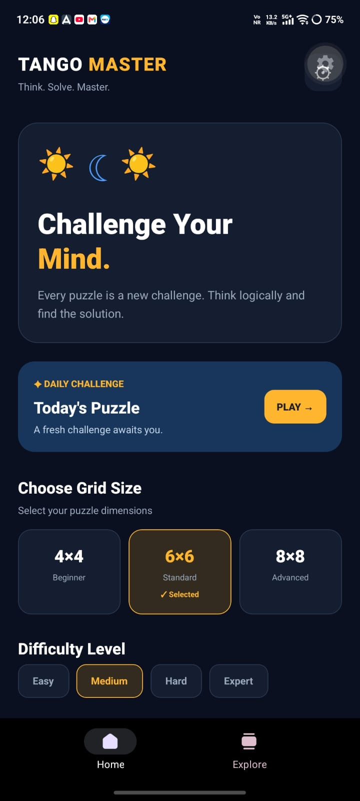
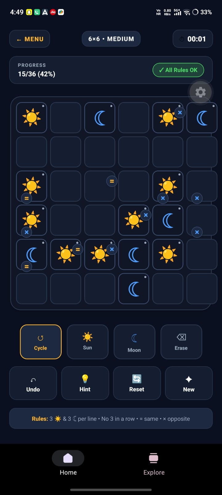
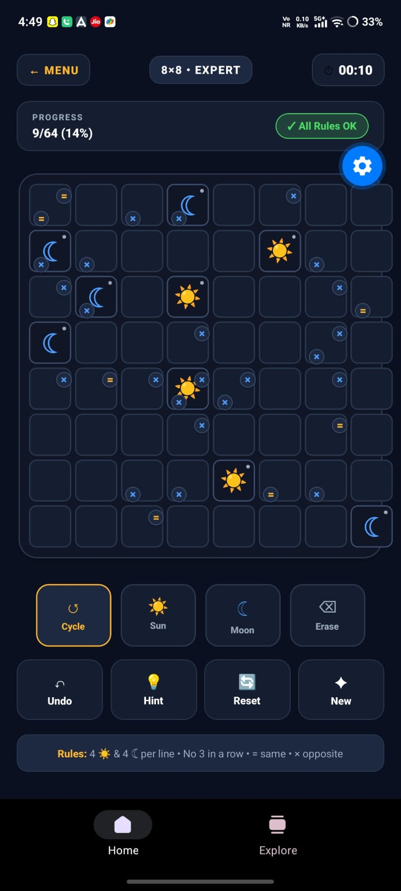

# 🌞 TANGO MASTER 🌙

**Think. Solve. Master.**

TANGO MASTER is a Sun-and-Moon logic puzzle game built with **React Native, Expo, and TypeScript**.

Fill the grid with Suns ☀️ and Moons 🌙 while satisfying row, column, and adjacency rules.

## ✨ Features

- Three grid sizes: 4×4, 6×6, and 8×8.
- Four difficulty levels: Easy, Medium, Hard, and Expert.
- Procedural puzzle generation.
- Puzzle solver and intelligent hint engine.
- Live puzzle validation.
- Sound effects and haptic feedback.
- Dark, Light, and System appearance settings.
- Persistent preferences and reset functionality.

## 🎮 How to Play

Fill every cell with either a Sun or Moon.

Follow these five rules:

1. **Equal row counts:** Every row must contain equal numbers of Suns and Moons.
2. **Equal column counts:** Every column must contain equal numbers of Suns and Moons.
3. **No three identical symbols:** Never place three identical symbols consecutively, horizontally or vertically.
4. **Equal (=):** Connected adjacent cells must contain identical symbols.
5. **Cross (×):** Connected adjacent cells must contain opposite symbols.

## 🛠️ Tech Stack

- React Native
- Expo SDK 58
- Expo Router
- React 19
- TypeScript 6

## 🚀 Getting Started

### Requirements
- Node.js and npm
- Expo Go or Android emulator
- Git

### 1. Clone the repository

```bash
git clone https://github.com/SANKET-v47/TANGO-MASTER.git
cd TANGO-MASTER
```

### 2. Install dependencies

```bash
npm install
```

### 3. Start the application

```bash
npx expo start
```

Scan the QR code using Expo Go on your phone.

## 📋 Available Commands

| Command | Description |
|---|---|
| `npm start` | Start Expo |
| `npm run android` | Run Android |
| `npm run ios` | Run iOS simulator |
| `npm run web` | Run web version |
| `npm test` | Run unit tests |
| `npm run lint` | Run lint checks |
| `npx tsc --noEmit` | TypeScript verification |

## 📁 Project Structure

```text
TANGO-MASTER/
├── assets/
├── scripts/
├── src/
│   ├── app/
│   ├── components/
│   │   ├── game/
│   │   └── settings/
│   └── game/
│       ├── __tests__/
│       ├── audio.ts
│       ├── colors.ts
│       ├── generator.ts
│       ├── settings.ts
│       ├── solver.ts
│       ├── types.ts
│       ├── use-game-state.ts
│       └── validation.ts
├── app.json
├── package.json
└── tsconfig.json
```

## 🧪 Testing

Run:

```bash
npm test
```

The test suite covers:

- Row and column symbol counts.
- Consecutive-symbol restrictions.
- Equal and Cross constraints.
- 4×4, 6×6, and 8×8 board validation.
- Procedural puzzle generation.
- Solver and hint engine.
- Settings persistence and reset functionality.

**Previously verified:** 8 puzzle tests passed, 5 settings tests passed, and TypeScript verification completed with zero errors.

## 📱 Application Screenshots

Explore the TANGO MASTER mobile application.

### 🏠 Home Screen




### 🎮 Puzzle Gameplay

**4×4 – Beginner / Quick Challenge**


**6×6 – Standard Challenge**



**8×8 – Advanced Challenge**



The game includes interactive puzzle cells, progress tracking, hints, undo, reset, and new puzzle generation.
## 📌 Project Status

TANGO MASTER is an active project. The repository includes the game interface, puzzle engine, settings implementation, and automated tests.

Contributions, bug reports, and suggestions are welcome.

## 👨‍💻 Author

**SANKET-v47**

GitHub: [@SANKET-v47](https://github.com/SANKET-v47)

Project: [TANGO MASTER](https://github.com/SANKET-v47/TANGO-MASTER)

---

*Made with React Native, Expo, and TypeScript.*
